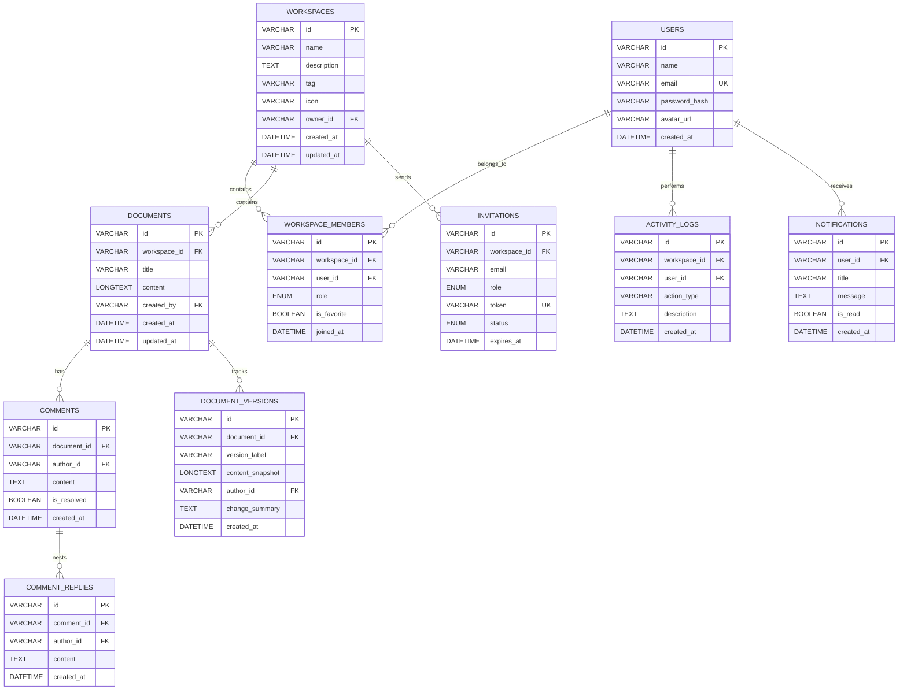

# SyncSpace – Database Schema Design (MySQL)

## 1. Schema Design Strategy

The SyncSpace database is fully normalized (3NF) to maintain referential integrity, eliminate data anomalies, and guarantee fast lookups for workspaces, memberships, and document revisions.

### Key Highlights
- **Primary Keys**: UUID / ULID or Auto-Increment IDs with indexed lookup identifiers.
- **Foreign Key Constraints**: `ON DELETE CASCADE` applied to child entities (e.g., deleting a workspace removes its documents and memberships; deleting a document removes its comments and version history).
- **Composite Indexes**: Added to high-frequency query filters such as `(workspace_id, is_favorite)` and `(document_id, created_at)`.
- **Role Constraints**: Enum constraints for `role` (`'owner'`, `'editor'`, `'viewer'`).

---

## 2. Table Definitions

---

## 3. Initial SQL Schema File (`database/schema.sql`)

The ready-to-run schema file is maintained in [schema.sql](file:///c:/Users/ADMIN/Downloads/React%20SYNC/database/schema.sql).
