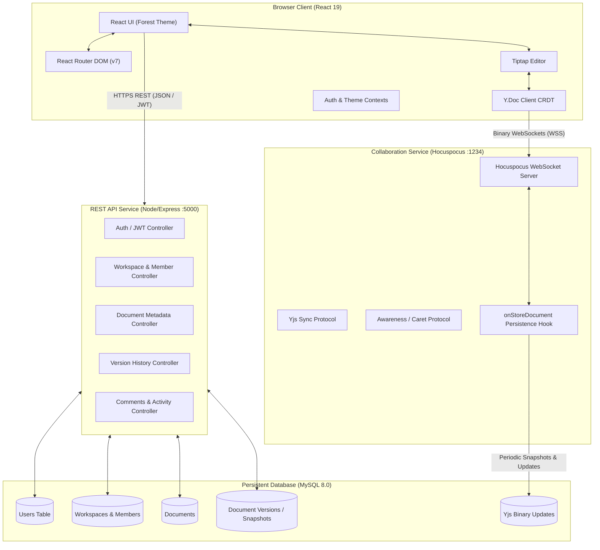

# SyncSpace – System Architecture Specification

## 1. Architectural Overview

SyncSpace employs a dual-channel architecture:
1. **Application REST Channel**: Express.js and MySQL handling authentication, workspace metadata, team permissions, comment threads, and explicit document revision snapshots.
2. **Real-Time Collaboration Channel**: Yjs Conflict-Free Replicated Data Types (CRDTs) over WebSockets mediated by Hocuspocus for sub-second cursor presence and concurrent multi-user rich text synchronization.



---

## 2. Communication Pipeline: How the Technologies Interact

### A. React to Express (REST Operations)
- **Protocol**: HTTP/1.1 or HTTP/2, JSON payloads.
- **Authentication**: `Authorization: Bearer <JWT>` header attached by an Axios request interceptor.
- **Operations Handled**:
  - User registration, login, profile updates.
  - Workspace creation, deletion, role assignment, and invitations.
  - In-document commenting, resolution, and reply nesting.
  - Creating and restoring explicit document revision snapshots.

### B. React to Hocuspocus (Real-Time Document Synchronization)
- **Protocol**: Binary WebSockets (`ws://` or `wss://`).
- **Data Model**: Yjs CRDT document instances (`Y.Doc`).
- **Workflow**:
  1. When a user opens a document (`/workspaces/:workspaceId/documents/:documentId`), React instantiates a `HocuspocusProvider`.
  2. The provider binds the Tiptap editor instance to the document's shared `Y.XmlFragment`.
  3. User keystrokes generate fine-grained CRDT delta operations (`Uint8Array`) transmitted instantly to the Hocuspocus server.
  4. Hocuspocus broadcasts these deltas to all other active clients connected to the same `documentId`.
  5. The Yjs CRDT algorithm merges changes deterministically, guaranteeing convergence without merge conflicts.

### C. Collaborator Presence & Remote Cursors
- Managed via the **Yjs Awareness Protocol**.
- Each client sends awareness state:
  ```json
  {
    "user": {
      "id": "usr_101",
      "name": "Alex Rivera",
      "color": "#328565",
      "avatar": "https://..."
    },
    "cursor": {
      "anchor": 42,
      "head": 55
    }
  }
  ```
- Tiptap's `CollaborationCaret` renders the remote collaborator's name pill and caret position in real time.

### D. Persistence Strategy (Separation of Sync vs Database)
A common beginner mistake is confusing **ephemeral real-time synchronization** with **permanent database persistence**.
SyncSpace implements a dual-persistence strategy:
1. **Real-Time Deltas**: Hocuspocus persists the merged binary Yjs state to MySQL via the `onStoreDocument` hook on debounced intervals.
2. **Explicit Snapshots**: When users trigger a document save or snapshot, a complete HTML/Markdown snapshot is written to the `DocumentVersions` table.
